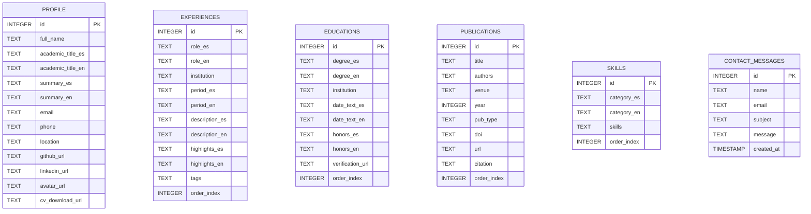

# System Data Dictionary

**Project:** Personal & Academic Website — Dr. José Daniel Narváez Flores  
**Version:** 1.0.0 (Initial Analysis and Design Baseline)  
**Persistence Engine:** SQLite 3  
**Date:** October 2026  
**Status:** In initial review  

---

## 1. Conventions and Standards

### 1.1 Naming Conventions
- **Table names:** Written in lowercase plural or singular according to the entity concept (`profile`, `experiences`, `educations`, `publications`, `skills`, `contact_messages`).
- **Column names (DB):** `snake_case` format (e.g., `academic_title_es`, `verification_url`).
- **Property names in API / DTOs:** `camelCase` format for idiomatic JavaScript/React compatibility (e.g., `academicTitle`, `verificationUrl`).
- **Localization suffixes:** Language-dependent attributes use the `_es` suffix for Spanish and `_en` for English in the database and domain models.

### 1.2 Data Type Mapping
| Logical Type | Physical Type (SQLite) | Python Type | TypeScript / JS Type |
| :--- | :--- | :--- | :--- |
| Auto-incrementing Integer | `INTEGER PRIMARY KEY AUTOINCREMENT` | `int` | `number` |
| Integer | `INTEGER` | `int` | `number` |
| Short Text / String | `TEXT` | `str` | `string` |
| Long Text / Paragraph | `TEXT` | `str` | `string` |
| Serialized Array (JSON) | `TEXT` | `List[str]` | `string[]` |
| Timestamp | `TIMESTAMP` | `str` / `datetime` | `string` (ISO 8601) |

---

## 2. Logical Entity-Relationship Diagram



---

## 3. Detailed Table Specifications

### 3.1 Table: `profile`
- **Description:** Stores fundamental biographical information, professional contact details, scientific network links, and downloadable resource links for Dr. José Daniel Narváez Flores.
- **Primary Key:** `id`

| Column | SQLite Type | Nullable | Default | Description & Business Rules | Example Value |
| :--- | :--- | :--- | :--- | :--- | :--- |
| `id` | `INTEGER` | NO | AUTOINCREMENT | Unique numeric identifier for the profile record. | `1` |
| `full_name` | `TEXT` | NO | None | Full name with academic honorific. | `"Dr. José Daniel Narváez Flores"` |
| `academic_title_es` | `TEXT` | NO | None | Academic title and specialization tracks in Spanish. | `"Doctor en Informática \| Investigador en CS e IA \| Ingeniero de Sistemas"` |
| `academic_title_en` | `TEXT` | NO | None | Academic title and specialization tracks in English. | `"Ph.D. in Computer Science \| CS & AI Researcher \| Systems Engineer"` |
| `summary_es` | `TEXT` | NO | None | Biographical summary and research tracks in Spanish. | `"Doctor en Informática por la Universidad Abierta Interamericana (UAI)..."` |
| `summary_en` | `TEXT` | NO | None | Biographical summary and research tracks in English. | `"Ph.D. in Computer Science from Universidad Abierta Interamericana (UAI)..."` |
| `email` | `TEXT` | NO | None | Primary professional contact email address. | `"jdnarvaezf@gmail.com"` |
| `phone` | `TEXT` | NO | None | Phone number in international format with country code. | `"+505 5774 1987"` |
| `location` | `TEXT` | NO | None | City and country of habitual residence. | `"Rivas, Nicaragua"` |
| `github_url` | `TEXT` | NO | None | Link to GitHub profile with code repositories. | `"https://github.com/jdanieln"` |
| `linkedin_url` | `TEXT` | NO | None | Link to official LinkedIn profile. | `"https://linkedin.com/in/jdanielnf"` |
| `avatar_url` | `TEXT` | YES | `NULL` | URL of the hosted official profile picture. | `"https://avatars.githubusercontent.com/u/53232152?v=4"` |
| `cv_download_url` | `TEXT` | YES | `NULL` | Direct path or URL to download the Curriculum Vitae in PDF. | `"/cv/CV_Daniel_Narvaez.pdf"` |

---

### 3.2 Table: `experiences`
- **Description:** Records professional, academic, teaching, and consulting history in reverse chronological order.
- **Primary Key:** `id`

| Column | SQLite Type | Nullable | Default | Description & Business Rules | Example Value |
| :--- | :--- | :--- | :--- | :--- | :--- |
| `id` | `INTEGER` | NO | AUTOINCREMENT | Unique numeric identifier for the experience. | `1` |
| `role_es` | `TEXT` | NO | None | Official job title or professional role in Spanish. | `"Profesor Adjunto e Investigador en CS e IA"` |
| `role_en` | `TEXT` | NO | None | Official job title or professional role in English. | `"Adjunct Professor & Researcher in CS and AI"` |
| `institution` | `TEXT` | NO | None | Name of the entity, university, or organization. | `"Keiser University"` |
| `period_es` | `TEXT` | NO | None | Descriptive time range in Spanish. | `"Ene 2026 - Presente"` |
| `period_en` | `TEXT` | NO | None | Descriptive time range in English. | `"Jan 2026 - Present"` |
| `description_es` | `TEXT` | NO | None | Concise description of responsibilities in Spanish. | `"Docencia e investigación de frontera en Ciencias de la Computación..."` |
| `description_en` | `TEXT` | NO | None | Concise description of responsibilities in English. | `"Teaching and cutting-edge research in Computer Science..."` |
| `highlights_es` | `TEXT` | YES | `NULL` | JSON array of bullet points highlighting key accomplishments in Spanish. | `'["Impartición de lecciones avanzadas...", "Investigación en AI4SE..."]'` |
| `highlights_en` | `TEXT` | YES | `NULL` | JSON array of bullet points highlighting key accomplishments in English. | `'["Delivery of advanced lectures...", "Active research in AI4SE..."]'` |
| `tags` | `TEXT` | YES | `NULL` | JSON array with technology stack or thematic area tags. | `'["AI4SE", "Machine Learning", "Research"]'` |
| `order_index` | `INTEGER` | YES | `0` | Display ordering criterion (lower value appears first). | `1` |

---

### 3.3 Table: `educations`
- **Description:** Stores official academic degrees (Ph.D., Master's, Bachelor's/Engineering degrees) alongside verifiable electronic credentials.
- **Primary Key:** `id`

| Column | SQLite Type | Nullable | Default | Description & Business Rules | Example Value |
| :--- | :--- | :--- | :--- | :--- | :--- |
| `id` | `INTEGER` | NO | AUTOINCREMENT | Unique numeric identifier for the academic degree. | `1` |
| `degree_es` | `TEXT` | NO | None | Official degree/title name in Spanish. | `"Doctorado en Informática"` |
| `degree_en` | `TEXT` | NO | None | Official degree/title name in English. | `"Ph.D. in Computer Science"` |
| `institution` | `TEXT` | NO | None | Degree-granting university or institution. | `"Universidad Abierta Interamericana (UAI)"` |
| `date_text_es` | `TEXT` | NO | None | Issuance or graduation date string in Spanish. | `"Feb 2026"` |
| `date_text_en` | `TEXT` | NO | None | Issuance or graduation date string in English. | `"Feb 2026"` |
| `honors_es` | `TEXT` | YES | `NULL` | Honors, distinctions, or thesis title in Spanish. | `"Tesis: 'Descubrimiento y diseño de microservicios...'"` |
| `honors_en` | `TEXT` | YES | `NULL` | Honors, distinctions, or thesis title in English. | `"Thesis: 'AI-assisted Discovery and Design of Microservices...'"` |
| `verification_url` | `TEXT` | YES | `NULL` | Official URL for electronic verification (institutional repository or CSV validator). | `"https://repositorio.uai.edu.ar/..."` |
| `order_index` | `INTEGER` | YES | `0` | Ordering criterion for chronological display. | `1` |

---

### 3.4 Table: `publications`
- **Description:** Catalog of indexed journal articles, international conference proceedings, doctoral theses, and technical workshops.
- **Primary Key:** `id`

| Column | SQLite Type | Nullable | Default | Description & Business Rules | Example Value |
| :--- | :--- | :--- | :--- | :--- | :--- |
| `id` | `INTEGER` | NO | AUTOINCREMENT | Unique numeric identifier for the publication. | `1` |
| `title` | `TEXT` | NO | None | Full title of the scientific article or publication. | `"MAPE-KV: A Knowledge-Validation Loop for Architecture Discovery"` |
| `authors` | `TEXT` | NO | None | Comma-separated list of authors. | `"Narváez, J. D., & Colaboradores"` |
| `venue` | `TEXT` | NO | None | Name of the journal, symposium, conference, or publisher. | `"IEEE Transactions on Software Engineering"` |
| `year` | `INTEGER` | NO | None | Official year of publication. | `2025` |
| `pub_type` | `TEXT` | NO | None | Publication category (`journal`, `conference`, `thesis`, `workshop`). | `"journal"` |
| `doi` | `TEXT` | YES | `NULL` | Digital Object Identifier of the scientific paper. | `"10.1109/TSE.2025.0001"` |
| `url` | `TEXT` | YES | `NULL` | Direct link to the PDF, repository, or official publication page. | `"https://doi.org/10.1109/TSE.2025.0001"` |
| `citation` | `TEXT` | YES | `NULL` | Standardized bibliographic citation for quick copying by users. | `"Narváez, J. D. (2025). MAPE-KV... IEEE TSE."` |
| `order_index` | `INTEGER` | YES | `0` | Position index for featured display. | `1` |

---

### 3.5 Table: `skills`
- **Description:** Thematic groupings of technical, research, programming, and tooling competencies.
- **Primary Key:** `id`

| Column | SQLite Type | Nullable | Default | Description & Business Rules | Example Value |
| :--- | :--- | :--- | :--- | :--- | :--- |
| `id` | `INTEGER` | NO | AUTOINCREMENT | Unique numeric identifier for the category. | `1` |
| `category_es` | `TEXT` | NO | None | Skill category name in Spanish. | `"Investigación & Métodos Formales"` |
| `category_en` | `TEXT` | NO | None | Skill category name in English. | `"Research & Formal Methods"` |
| `skills` | `TEXT` | NO | None | JSON array of strings containing individual competencies in the category. | `'["AI4SE", "Lean 4", "Neuro-Symbolic Systems", "Formal Verification"]'` |
| `order_index` | `INTEGER` | YES | `0` | Display order for the thematic block. | `1` |

---

### 3.6 Table: `contact_messages`
- **Description:** Historical audit log of messages submitted by users via the web contact form.
- **Primary Key:** `id`

| Column | SQLite Type | Nullable | Default | Description & Business Rules | Example Value |
| :--- | :--- | :--- | :--- | :--- | :--- |
| `id` | `INTEGER` | NO | AUTOINCREMENT | Sequential numeric identifier for the received message. | `1` |
| `name` | `TEXT` | NO | None | Sender's name. Minimum 2 characters. | `"Dr. Carlos Mendoza"` |
| `email` | `TEXT` | NO | None | Sender's valid email address. | `"carlos.mendoza@universidad.edu"` |
| `subject` | `TEXT` | NO | None | Contact subject or reason. Minimum 3 characters. | `"Colaboración en Taller de Verificación Formal"` |
| `message` | `TEXT` | NO | None | Text body of the message. Minimum 10 characters. | `"Estimado Dr. Narváez, nos gustaría invitarlo a dictar una ponencia..."` |
| `created_at` | `TIMESTAMP` | YES | `CURRENT_TIMESTAMP` | UTC timestamp generated automatically by SQLite on insert. | `"2026-10-02 15:30:00"` |

---

## 4. JSON-Serialized Data Structures

To optimize relational design without introducing join overhead for atomic collections that are always consumed together, JSON-serialized `TEXT` fields are used:

### 4.1 Format of `highlights_es` and `highlights_en` (`experiences`)
```json
[
  "Impartición de lecciones avanzadas y mentoría de estudiantes en desafíos técnicos complejos.",
  "Investigación activa en AI4SE orientada a la difusión en la comunidad científica internacional."
]
```

### 4.2 Format of `tags` (`experiences`)
```json
[
  "AI4SE",
  "Machine Learning",
  "Research",
  "Higher Education"
]
```

### 4.3 Format of `skills` (`skills`)
```json
[
  "AI4SE",
  "Verificación Formal con Lean 4",
  "Sistemas Neuro-Simbólicos (ArchiGenMS, MAPE-KV)",
  "Matemática Computacional y Optimización",
  "Computación Cuántica"
]
```

---

## 5. REST API Contracts (DTOs)

### 5.1 Localized Profile Response (`GET /api/profile?lang=es|en`)
```json
{
  "id": 1,
  "fullName": "Dr. José Daniel Narváez Flores",
  "academicTitle": "Doctor en Informática | Investigador en CS e IA | Ingeniero de Sistemas",
  "summary": "Doctor en Informática por la Universidad Abierta Interamericana (UAI)...",
  "email": "jdnarvaezf@gmail.com",
  "phone": "+505 5774 1987",
  "location": "Rivas, Nicaragua",
  "githubUrl": "https://github.com/jdanieln",
  "linkedinUrl": "https://linkedin.com/in/jdanielnf",
  "avatarUrl": "https://avatars.githubusercontent.com/u/53232152?v=4",
  "cvDownloadUrl": "/cv/CV_Daniel_Narvaez.pdf"
}
```

### 5.2 Contact Message Submission Request (`POST /api/contact`)
#### Request Payload:
```json
{
  "name": "Dr. Carlos Mendoza",
  "email": "carlos.mendoza@universidad.edu",
  "subject": "Invitación a Ponencia Internacional",
  "message": "Estimado Dr. Narváez, le extendemos una cordial invitación para participar en..."
}
```

#### Response Payload (201 Created):
```json
{
  "success": true,
  "message": "Message sent successfully",
  "id": 1
}
```

#### Response Payload (400 Bad Request):
```json
{
  "error": "All fields (name, email, subject, and message) are required and must be valid."
}
```
