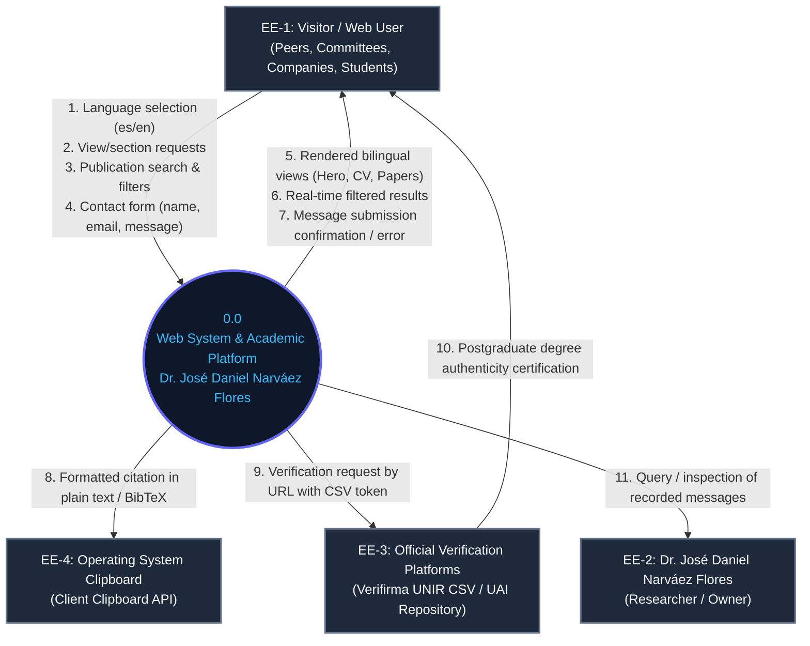
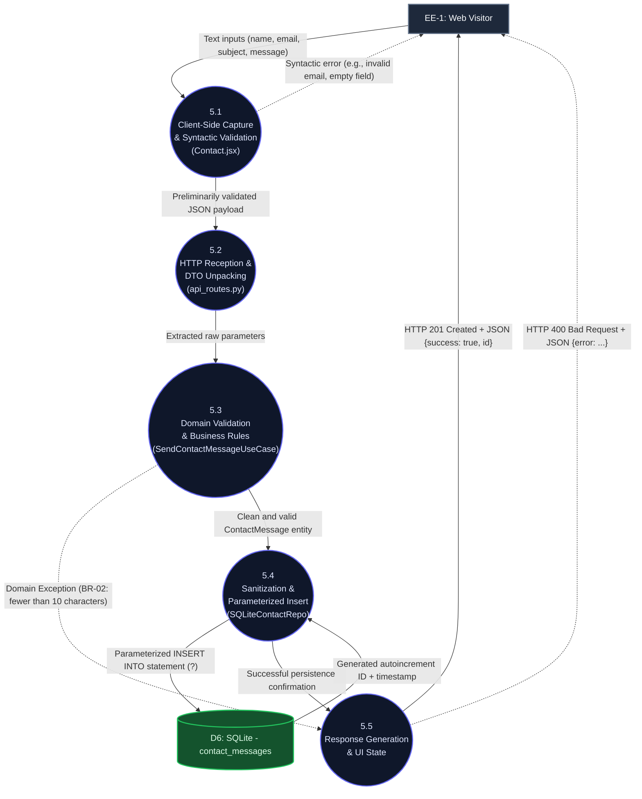
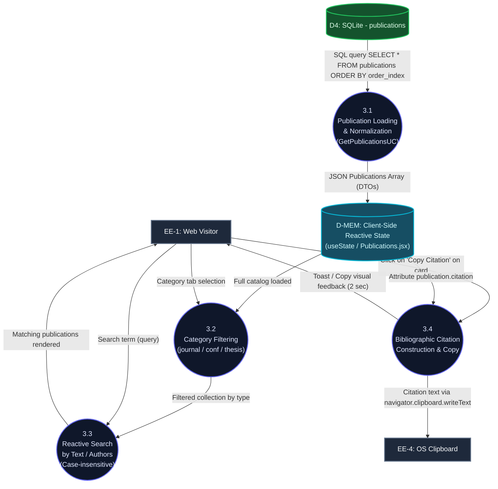
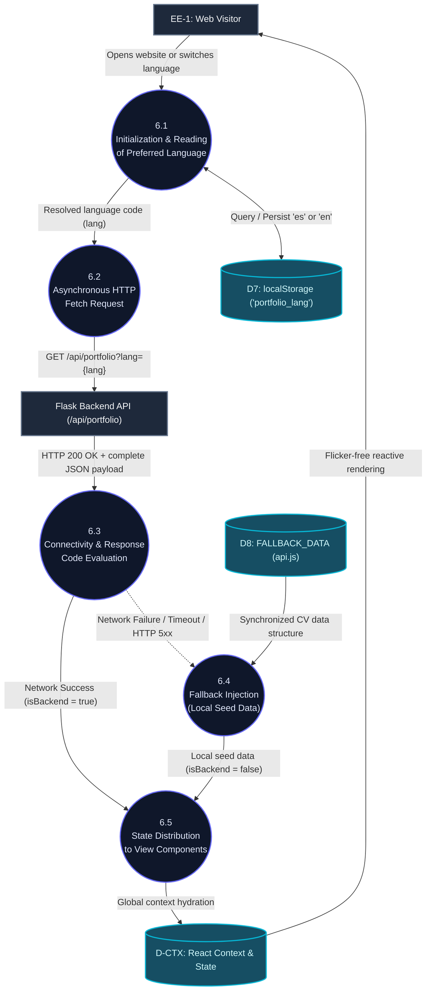

# System Data Flow Diagrams (DFD)

**Project:** Personal & Academic Website — Dr. José Daniel Narváez Flores  
**Version:** 1.0.0 (Analysis and Architecture Baseline)  
**Date:** October 2026  
**Status:** Approved / In effect  

---

## 1. Introduction and Notation

This document formalizes the **Data Flow Diagrams (DFD)** of the system. The DFDs model the functional perspective and information movement across system boundaries: they specify where data originates, what transformations and validations it undergoes across logical layers, which persistence stores safeguard it, and what information is delivered to users and external entities.

### 1.1 Notation and Symbology (Gane & Sarson / Yourdon)

To maximize visual clarity and compatibility with markdown rendering and CI/CD tools, diagrams are implemented in **Mermaid** following formal software engineering conventions:

| DFD Element | Graphical Representation | Notation | Description |
| :--- | :---: | :--- | :--- |
| **External Entity (Terminator)** | `[External Entity]` | Solid rectangle | Source of input data or destination of output data outside system boundaries. |
| **Transformation Process** | `((X.0 Process))` or `(X.0 Process)` | Circle or rounded rectangle | Function or subsystem that transforms or processes incoming data flows. |
| **Data Store** | `[(DX: Store)]` | Open cylinder / container | Passive structured data repository (SQLite table, backup file, or local storage). |
| **Data Flow** | `── Data ──▶` | Labeled arrow | Directed vector carrying defined data packets between entities, processes, and stores. |

---

## 2. Catalog of System Elements

### 2.1 External Entities (Terminators)
- **EE-1: Visitor / Web User:** Peer researchers, evaluation committees, academic directors, talent recruiters, students, and the general public.
- **EE-2: Owner / Dr. José Daniel Narváez Flores:** Curricular administrator and recipient of professional/academic inquiries.
- **EE-3: Official Verification Platforms (CSV & Repositories):** External credential authentication systems (UNIR Mexico Verifirma server for official degrees with CSV verification codes, and UAI Institutional Repository for the doctoral dissertation).
- **EE-4: Operating System Clipboard (Clipboard API):** Client-side environment subsystem where formatted bibliographic citations are transferred.

### 2.2 Data Stores
- **D1: SQLite `profile`:** Master record containing biography, titles, profile photo, contact details, and institutional links.
- **D2: SQLite `experiences`:** History of professional positions and university professorships with accomplishment highlights and technical tags.
- **D3: SQLite `educations`:** Postgraduate and undergraduate degrees, honors, GPAs, and electronic verification links (CSV).
- **D4: SQLite `publications`:** Catalog of indexed scientific output, conference proceedings, dissertations, DOI links, and standard citations.
- **D5: SQLite `skills`:** Technical capability clusters (Research, Programming Languages, Cloud/DevOps, Spoken Languages).
- **D6: SQLite `contact_messages`:** Transactional audit log of inquiries and proposals received via the web form.
- **D7: Client `localStorage`:** Browser persistent storage for remembering user language preference (`lang`).
- **D8: Client `FALLBACK_DATA` (Resilient Seed):** Static cache bundled in the frontend to ensure offline functionality.

---

## 3. Context Diagram (DFD Level 0)

The **Context Diagram** represents the system at its highest level of abstraction as a single entity (Process `0.0`), defining the software boundary and all data exchanges with the external environment.

---

## 4. Functional Decomposition Diagram (DFD Level 1)

The **Level 1 Diagram** opens the system's black box, breaking down the architecture into six functional macro-processes and displaying their connections to relational data stores (`D1` through `D6`) and client-side stores (`D7`, `D8`).

```mermaid
flowchart TD
    %% External Entities
    EE1["EE-1: Web Visitor"]
    EE3["EE-3: Verifirma / UAI Repository"]
    EE4["EE-4: OS Clipboard"]

    %% Level 1 Processes
    P1(("1.0<br/>Identity & Profile<br/>Management & Query"))
    P2(("2.0<br/>Trajectory & Degree<br/>Management & Verification"))
    P3(("3.0<br/>Publication Browsing,<br/>Filtering & Citation"))
    P4(("4.0<br/>Technical Skills<br/>Classification & Query"))
    P5(("5.0<br/>Contact Reception,<br/>Validation & Recording"))
    P6(("6.0<br/>Data Orchestration,<br/>Language & Offline Fallback"))

    %% Data Stores
    D1[("D1: SQLite - profile")]
    D2[("D2: SQLite - experiences")]
    D3[("D3: SQLite - educations")]
    D4[("D4: SQLite - publications")]
    D5[("D5: SQLite - skills")]
    D6[("D6: SQLite - contact_messages")]
    D7[("D7: LocalStorage (lang)")]
    D8[("D8: Seed Cache (FALLBACK_DATA)")]

    %% P6 Flows (Orchestrator / Resilience / Language)
    EE1 -->|"Language selection (es/en)"| P6
    P6 <-->|"Read / Write preference"| D7
    P6 -.->|"Fallback injection if backend is unreachable"| D8

    %% Process 1.0 Flows (Profile)
    P6 -->|"Profile request with ?lang="| P1
    D1 -->|"Bilingual profile record"| P1
    P1 -->|"Localized Profile DTO (name, bio, links)"| P6

    %% Process 2.0 Flows (Trajectory and Education)
    P6 -->|"Experience and education request"| P2
    D2 -->|"Chronological experiences list"| P2
    D3 -->|"Academic degrees list and CSV URLs"| P2
    P2 -->|"Validated Experience and Education DTOs"| P6
    P2 -->|"External link with CSV cryptographic token"| EE3

    %% Process 3.0 Flows (Publications)
    EE1 -->|"Search criteria and paper type"| P3
    D4 -->|"Indexed papers, metadata, and citations"| P3
    P3 -->|"Filtered papers list"| EE1
    P3 -->|"Copy bibliographic citation"| EE4

    %% Process 4.0 Flows (Skills)
    P6 -->|"Competencies request with ?lang="| P4
    D5 -->|"Competency clusters and skills"| P4
    P4 -->|"Skills DTO ordered by category"| P6

    %% Process 5.0 Flows (Contact)
    EE1 -->|"Form data (name, email, subject, message)"| P5
    P5 -->|"Sanitized message record"| D6
    P5 -->|"Receipt confirmation / Validation alert"| EE1

    %% Integrated flow from P6 to UI
    P6 -->|"Consolidated rendered portfolio payload"| EE1

    %% Styles
    classDef external fill:#1e293b,stroke:#64748b,stroke-width:2px,color:#f8fafc;
    classDef process fill:#0f172a,stroke:#6366f1,stroke-width:2px,color:#e0e7ff;
    classDef store fill:#14532d,stroke:#22c55e,stroke-width:2px,color:#dcfce7;
    classDef clientStore fill:#164e63,stroke:#06b6d4,stroke-width:2px,color:#cffafe;
    
    class EE1,EE3,EE4 external;
    class P1,P2,P3,P4,P5,P6 process;
    class D1,D2,D3,D4,D5,D6 store;
    class D7,D8 clientStore;
```

---

## 5. Level 2 Diagrams (Critical Process Decomposition)

The Level 2 diagrams model in detail the internal flows of the system's most dynamic and rigorous processes.

### 5.1 DFD Level 2 — Process 5.0: Messaging and Contact Subsystem

Shows the lifecycle of a message from user interaction in React to persistent storage in SQLite, traversing the layers of **Clean Architecture**.

---

### 5.2 DFD Level 2 — Process 3.0: Scientific Publication Browsing, Search, and Citation

Models how data moves during catalog loading, in-memory dynamic filtering, and bibliographic reference export to the clipboard.

---

### 5.3 DFD Level 2 — Process 6.0: Orchestration, Bilingualism, and Offline Resilience

Models how the client decides to consume the backend API or resort to the fallback cache, synchronizing language preferences.

---

## 6. Data Flow Dictionary

Atomic specification of data structures traveling across the communication channels identified in the diagrams:

| Flow Identifier | Source | Destination | Format / Protocol | Attributes and Data Content |
| :--- | :--- | :--- | :--- | :--- |
| `FD-01: Language Selection` | Visitor | P6.1 / D7 | DOM Event / Key-Value | `lang`: ISO Code (`'es'` \| `'en'`). |
| `FD-02: Portfolio Query` | P6.2 | Backend API | HTTP GET (REST) | URL Query String: `?lang=es\|en`, Headers: `Accept: application/json`. |
| `FD-03: Full Portfolio DTO` | Backend API | P6.3 / P6.5 | HTTP 200 (JSON) | Composite object containing `{ profile, experiences, educations, publications, skills, lang }`. |
| `FD-04: Fallback Seed Data` | D8 | P6.4 | In-memory JS Object | Complete portfolio mirror structure curated with official curricular data. |
| `FD-05: Filter Criteria` | Visitor | P3.2 / P3.3 | React State (Input) | `category`: (`'all'`, `'journal'`, `'conference'`, `'thesis'`, `'workshop'`), `searchQuery`: `string`. |
| `FD-06: Bibliographic Citation` | P3.4 | EE-4 (Clipboard) | Plain text (UTF-8) | Formatted string: `"[Authors] ([Year]). [Title]. [Venue/Publisher]. DOI: [doi]"`. |
| `FD-07: External Verification` | P2.0 / UI | EE-3 (Verifirma / UAI) | HTTP Redirect / HTTPS GET | Absolute URL with institutional CSV token parameter or repository handle. |
| `FD-08: Contact Form` | Visitor | P5.1 | Form Submit Event | React object: `{ name: string, email: string, subject: string, message: string }`. |
| `FD-09: HTTP Contact Payload` | P5.1 | P5.2 | HTTP POST (JSON) | JSON Body: `{"name": "...", "email": "...", "subject": "...", "message": "..."}`. |
| `FD-10: Message Insert` | P5.3 | P5.4 / D6 | Parameterized SQL Tuple | `(name, email, subject, message)` inserted with `CURRENT_TIMESTAMP`. |
| `FD-11: Contact Confirmation` | P5.5 | Visitor | HTTP 201 (JSON) | `{"success": true, "id": number, "message": "Message sent successfully"}`. |
| `FD-12: Contact Error` | P5.3 / P5.5 | Visitor | HTTP 400/500 (JSON) | `{"error": string}` (Descriptive feedback message for UI). |

---

## 7. Traceability Matrix (DFD vs Requirements vs Architecture Layers)

| DFD Process | Covered SRS Requirement | Business Rule | Clean Architecture Layers Involved | Data Store |
| :--- | :--- | :--- | :--- | :--- |
| **1.0 Profile & Identity** | FR-01, FR-02, FR-03 | BR-01 | `presentation` ➔ `application (GetProfileUC)` ➔ `domain` ➔ `infrastructure (SQLite)` | `D1: profile`, `D7: localStorage` |
| **2.0 Trajectory & Degrees** | FR-04, FR-05 | BR-01, BR-03, BR-04 | `presentation` ➔ `application (GetExpUC, GetEduUC)` ➔ `domain` ➔ `infrastructure` | `D2: experiences`, `D3: educations` |
| **3.0 Scientific Publications** | FR-07, FR-08 | BR-01 | `presentation` ➔ `application (GetPubUC)` ➔ `domain` ➔ `infrastructure` + Frontend Clipboard | `D4: publications` |
| **4.0 Technical Skills** | FR-06 | BR-01 | `presentation` ➔ `application (GetSkillsUC)` ➔ `domain` ➔ `infrastructure` | `D5: skills` |
| **5.0 Contact Messaging** | FR-09 | BR-02, BR-05 | `presentation (api_routes)` ➔ `application (SendContactUC)` ➔ `domain (ContactMessage)` ➔ `infrastructure` | `D6: contact_messages` |
| **6.0 Resilience & Fallback** | FR-10, FR-11 | BR-01 | `frontend/services/api.js` (Fault Tolerance Strategy) | `D7: localStorage`, `D8: FALLBACK_DATA` |

---

## 8. Security Considerations in Data Flows

1. **SQL Injection (SQLi) Mitigation:**
   - All flows interacting with `D1` through `D6` exclusively use prepared statements with positional parameter placeholders (`?`) via Python's `sqlite3` driver, preventing malicious payloads from altering query execution trees.
2. **Cross-Site Scripting (XSS) Mitigation:**
   - Data transmitted in `FD-08` and `FD-09` is sanitized and validated in `P5.3`. React escapes any content injected into the DOM by default, and Flask delivers responses with explicit `application/json`, preventing unauthorized script execution.
3. **Verification of Cryptographic CSV Links:**
   - In process `2.0`, external links pointing to institutional degree validation servers enforce HTTPS protocols and include `rel="noopener noreferrer"` attributes on frontend hyperlinks to prevent tabnabbing vulnerabilities.
