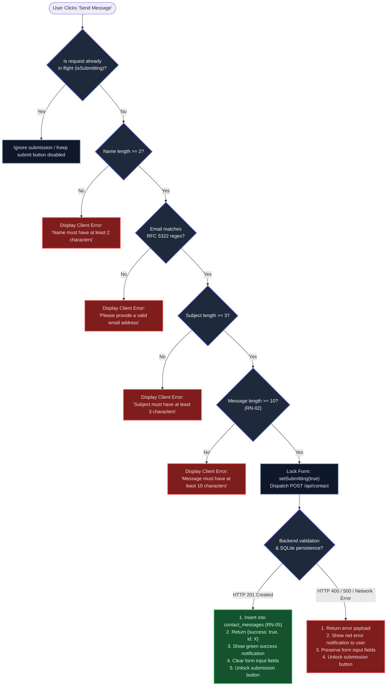
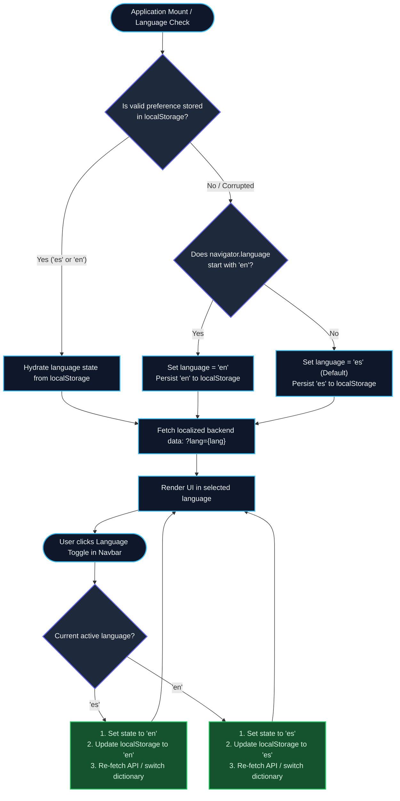
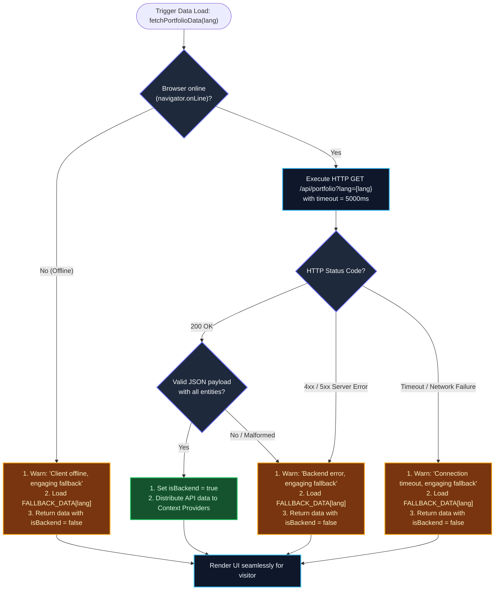
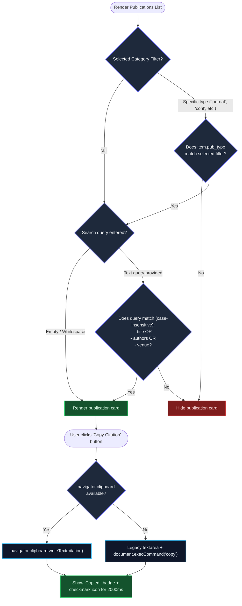
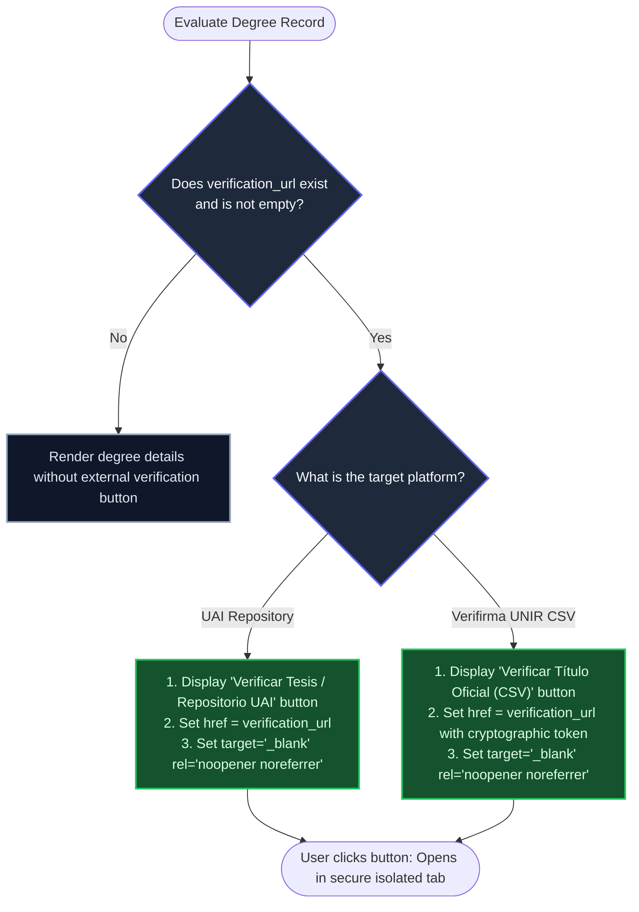

# System Decision Tables and Decision Trees

**Project:** Personal & Academic Website — Dr. José Daniel Narváez Flores  
**Version:** 1.0.0 (Analysis & Specification Baseline)  
**Date:** October 2026  
**Status:** Approved / In Effect  

---

## 1. Introduction and Objectives

This document establishes the **Decision Tables** and **Decision Trees** for the key functional requirements and business rules of the personal and academic web platform.

In software requirements engineering, decision tables and decision trees disambiguate complex conditional logic, ensure exhaustive test coverage, and prevent boundary edge-case failures across both frontend components and backend services.

### 1.1 Structural Conventions
- **Decision Tables:** Organized into Condition Stubs (inputs/predicates), Condition Entries (`Y` = Yes/True, `N` = No/False, `-` = Don't Care/Irrelevant), Action Stubs (outputs/operations), and Action Entries (`X` = Execute Action).
- **Decision Trees:** Rendered using **Mermaid** flowcharts depicting sequential evaluation nodes, decision branches, and terminating actions.

---

## 2. Decision Logic 1: Contact Form Validation & Submission (RF-09, RN-02, RN-05)

### 2.1 Context and Rules
The contact module receives messages from peers, academic committees, and industry partners. Per **RN-02** and **RN-05**, messages must satisfy strict syntactic and domain constraints before being persisted into SQLite. Double submissions must be prevented while a request is in flight.

### 2.2 Decision Table: Contact Form Processing

| Element | Condition / Action | R1 | R2 | R3 | R4 | R5 | R6 | R7 |
| :--- | :--- | :---: | :---: | :---: | :---: | :---: | :---: | :---: |
| **Condition Stubs** | Already Submitting (`isSubmitting == true`) | Y | N | N | N | N | N | N |
| | Valid Name (`name.trim().length >= 2`) | - | N | Y | Y | Y | Y | Y |
| | Valid Email (`RFC 5322 regex match`) | - | - | N | Y | Y | Y | Y |
| | Valid Subject (`subject.trim().length >= 3`) | - | - | - | N | Y | Y | Y |
| | Valid Message Body (`message.trim().length >= 10`) | - | - | - | - | N | Y | Y |
| | Backend Server Reachable & HTTP 201 | - | - | - | - | - | N | Y |
| **Action Stubs** | Block Form Submission / Ignore Click | X | - | - | - | - | - | - |
| | Show Client Error: "Name must be at least 2 characters" | - | X | - | - | - | - | - |
| | Show Client Error: "Please enter a valid email address" | - | - | X | - | - | - | - |
| | Show Client Error: "Subject must be at least 3 characters" | - | - | - | X | - | - | - |
| | Show Client Error: "Message must be at least 10 characters" | - | - | - | - | X | - | - |
| | Lock Form (`setSubmitting(true)`) & Dispatch `POST /api/contact` | - | - | - | - | - | X | X |
| | Insert Record into SQLite `contact_messages` | - | - | - | - | - | - | X |
| | Show Server Error Alert & Unlock Form | - | - | - | - | - | X | - |
| | Show Success Feedback Banner, Reset Form Fields & Unlock Form | - | - | - | - | - | - | X |

### 2.3 Decision Tree: Contact Form Lifecycle

---

## 3. Decision Logic 2: Language Resolution & Dynamic Internationalization (RF-02, RN-01)

### 3.1 Context and Rules
The website supports full dynamic internationalization between English (`en`) and Spanish (`es`) without page reloads. Per **RF-02** and **RN-01**, all presented content must be localized, the user preference must persist across browser sessions in `localStorage`, and a fallback default must be selected if no prior choice exists.

### 3.2 Decision Table: Language Initialization and Toggling

| Element | Condition / Action | R1 | R2 | R3 | R4 | R5 |
| :--- | :--- | :---: | :---: | :---: | :---: | :---: |
| **Condition Stubs** | Trigger Event | Mount | Mount | Mount | Toggle | Toggle |
| | Valid `localStorage['portfolio_lang']` present (`'es'` \| `'en'`) | Y | N | N | - | - |
| | Browser Locale starts with `'en'` (`navigator.language`) | - | Y | N | - | - |
| | Active Language prior to toggle was `'es'` | - | - | - | Y | N |
| **Action Stubs** | Set Language state to stored preference | X | - | - | - | - |
| | Set Language state to `'en'` | - | X | - | - | X |
| | Set Language state to `'es'` (Default fallback) | - | - | X | X | - |
| | Write updated language to `localStorage['portfolio_lang']` | - | X | X | X | X |
| | Re-fetch localized API data (`/api/portfolio?lang={selected}`) | X | X | X | X | X |
| | Re-render UI components with localized dictionary keys | X | X | X | X | X |

### 3.3 Decision Tree: Language Selection & Resolution

---

## 4. Decision Logic 3: Client Data Fetching, Network Status & Offline Fallback (RF-10, RF-11)

### 4.1 Context and Rules
To guarantee 100% uptime and resilience against server down-time or network interruptions, the client implements a **Fallback Strategy** in `frontend/src/services/api.js`. If the backend API cannot be reached or returns an error, the application seamlessly consumes bundled, verified seed data (`FALLBACK_DATA`).

### 4.2 Decision Table: Data Fetching and Fault Tolerance

| Element | Condition / Action | R1 | R2 | R3 | R4 |
| :--- | :--- | :---: | :---: | :---: | :---: |
| **Condition Stubs** | HTTP Response Code | 200 OK | 4xx / 5xx | Timeout / Error | Network Offline |
| | JSON Payload Valid & Non-Empty | Y | - | - | - |
| | Fallback Seed Data (`FALLBACK_DATA`) available | - | Y | Y | Y |
| **Action Stubs** | Parse and hydrate state with remote API payload | X | - | - | - |
| | Set `isBackendAvailable = true` | X | - | - | - |
| | Log warning to browser console | - | X | X | X |
| | Inject `FALLBACK_DATA` matching active `lang` | - | X | X | X |
| | Set `isBackendAvailable = false` | - | X | X | X |
| | Render portfolio seamlessly without UI break or white screen | X | X | X | X |

### 4.3 Decision Tree: API Request & Fallback Pipeline

---

## 5. Decision Logic 4: Publication Filtering, Search & Citation Export (RF-07, RF-08)

### 5.1 Context and Rules
The scientific publication explorer allows visitors to filter items by academic genre (`all`, `journal`, `conference`, `thesis`, `workshop`) and apply real-time text matching across title, authors, and venue. Users can also copy formatted citations to the system clipboard with instant UI visual feedback.

### 5.2 Decision Table: Publication Card Filtering & Citation Action

| Element | Condition / Action | R1 | R2 | R3 | R4 | R5 |
| :--- | :--- | :---: | :---: | :---: | :---: | :---: |
| **Condition Stubs** | Selected Category Filter | `'all'` | Specific Type | Specific Type | - | - |
| | Publication Type matches Selected Category | - | Y | N | - | - |
| | Search Query Input (`query.trim()`) | Empty | Matches Title/Author/Venue | No Match | - | - |
| | User clicks "Copy Citation" button | N | N | N | Y | Y |
| | Clipboard API supported (`navigator.clipboard`) | - | - | - | Y | N |
| **Action Stubs** | Render Publication Card in List | X | X | - | - | - |
| | Exclude Publication Card from Rendered List | - | - | X | - | - |
| | Copy `publication.citation` via `writeText()` | - | - | - | X | - |
| | Fallback: Copy via legacy `document.execCommand('copy')` | - | - | - | - | X |
| | Trigger 2-second visual confirmation ("Copied!" + Check Icon) | - | - | - | X | X |

### 5.3 Decision Tree: Publication Filtering and Citation Interaction

---

## 6. Decision Logic 5: Academic Degree Verification & Credential Dispatch (RF-05, RN-03)

### 6.1 Context and Rules
Per **RF-05** and **RN-03**, academic credentials must be backed by verifiable official electronic links. Depending on whether the credential is a doctoral dissertation or a master's degree from UNIR Mexico, the system routes users to the corresponding official validator (Institutional Repository vs. Mexican government CSV portal).

### 6.2 Decision Table: Degree Verification Dispatch

| Element | Condition / Action | R1 | R2 | R3 |
| :--- | :--- | :---: | :---: | :---: |
| **Condition Stubs** | Degree Category | Doctorate (Ph.D.) | Master's Degree (M.Sc.) | Undergraduate / Engineering |
| | Electronic Verification URL Present (`verification_url != null`) | Y | Y | N |
| | Verification Type | UAI Institutional Repository | Verifirma UNIR (CSV Code) | None |
| **Action Stubs** | Render "Verify Credential" Action Button | X | X | - |
| | Route to Official Repository (`https://repositorio.uai.edu.ar/...`) | X | - | - |
| | Route to Verifirma CSV Platform (`https://verifirma.unir.net/...`) | - | X | - |
| | Apply Security Attributes (`target="_blank" rel="noopener noreferrer"`) | X | X | - |
| | Display Degree Information without external link button | - | - | X |

### 6.3 Decision Tree: Degree Verification Button Routing

---

## 7. Traceability Matrix: Decision Logic vs Architecture Components

| Decision Logic | Covered Requirements | Business Rules | Frontend Implementation | Backend Implementation | Data Store |
| :--- | :--- | :--- | :--- | :--- | :--- |
| **DL-1: Contact Form** | RF-09, RNF-05 | RN-02, RN-05 | `Contact.jsx` (Syntactic validation & submit lock) | `api_routes.py`, `SendContactMessageUseCase`, `SQLiteContactRepo` | `D6: contact_messages` |
| **DL-2: Internationalization** | RF-01, RF-02, RF-10 | RN-01 | `LanguageContext.jsx`, `Navbar.jsx` | `api_routes.py` (`?lang=es\|en`), all `Get*UseCase(lang)` | `D7: localStorage`, SQLite `_es`/`_en` columns |
| **DL-3: Fallback Strategy** | RF-10, RF-11, RNF-01 | RN-01 | `services/api.js` (`FALLBACK_DATA`), `usePortfolioData.js` | Flask REST API endpoints | `D8: FALLBACK_DATA` (In-memory seed) |
| **DL-4: Publication Filtering** | RF-07, RF-08 | RN-01 | `Publications.jsx` (Filter tabs, search bar, Clipboard API) | `GetPublicationsUseCase` | `D4: publications` |
| **DL-5: Degree Verification** | RF-05 | RN-03 | `Education.jsx` (Verification action buttons) | `GetEducationsUseCase` | `D3: educations` (`verification_url`) |
